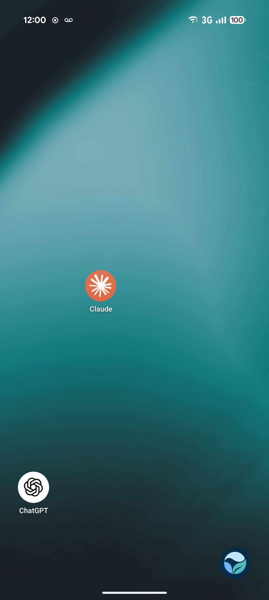
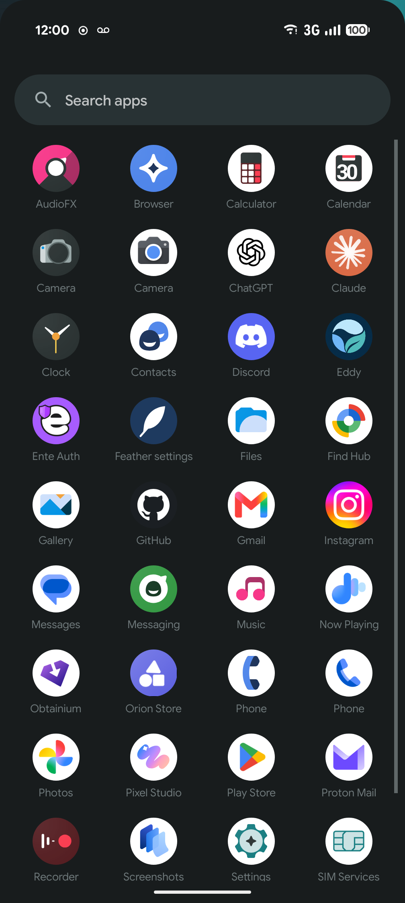
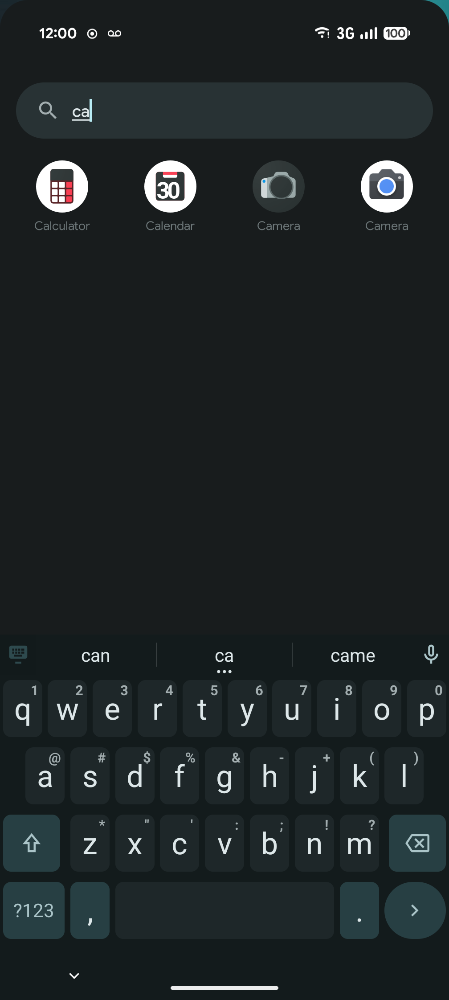
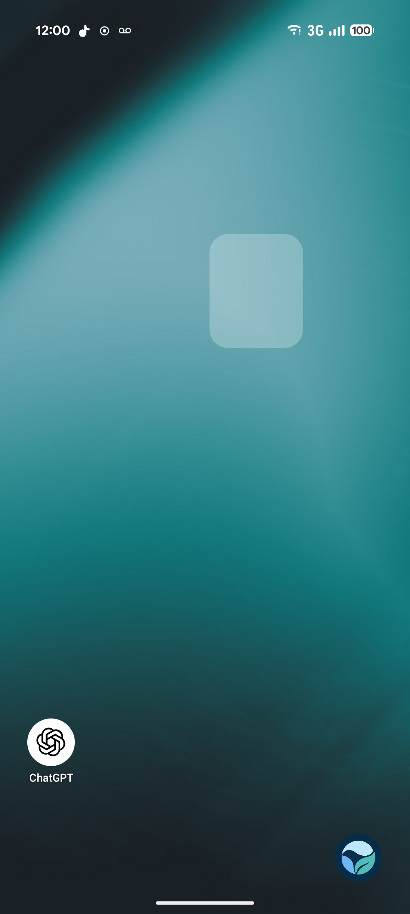
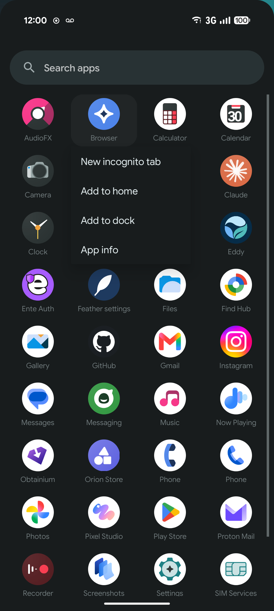
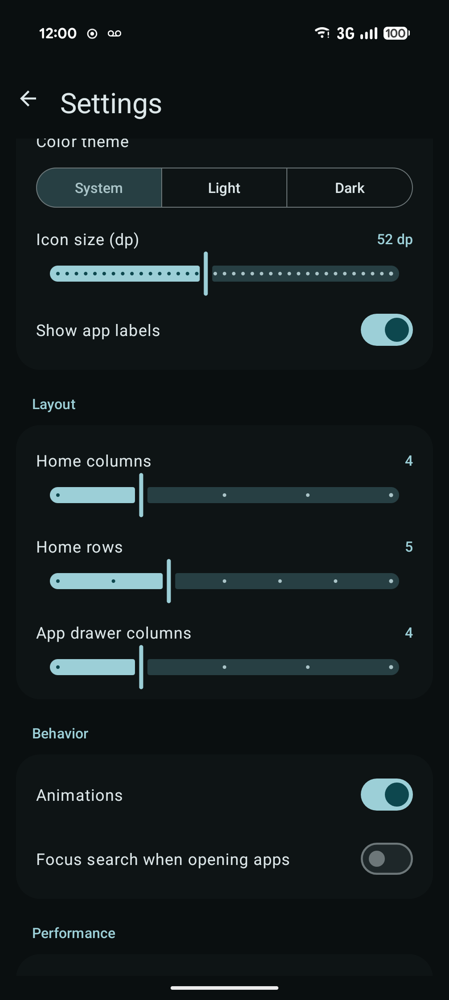

<div align="center">

# 🪶 Feather Launcher

**A home screen that weighs almost nothing.**

Clean like stock Android, with no feeds, no network access and no permissions.


<br>

&nbsp;&nbsp;
&nbsp;&nbsp;


</div>

---

## ✨ Features

<table>
<tr>
<td width="50%" valign="top">

### 🏠 Home and dock
- Icon grid with configurable rows and columns
- Dock for favorite apps
- Your system wallpaper, edge to edge
- Long-press empty space for Wallpaper and Settings

### 🔍 App drawer
- Swipe up from anywhere
- Alphabetical, with fast scroll
- Instant search that ignores case and accents ("cafe" finds "Café")
- Press Enter to open the first result

</td>
<td width="50%" valign="top">

### ✋ Drag and drop
- Long-press an icon and drag it
- The target cell lights up under your finger
- Drop on another app to swap the two

### ⚙️ The rest
- App shortcuts in the long-press menu
- Work profile apps, badged
- Material You colors, light and dark themes
- TalkBack: an "All apps" action on the home grid
- Survives reboots, app updates and paused profiles without losing your layout

</td>
</tr>
</table>

<div align="center">
&nbsp;&nbsp;
&nbsp;&nbsp;

<br>
<sub>Drag target highlight · Long-press menu with an app shortcut · Settings</sub>
</div>

---

## 🪶 Why it's light

| | |
|---|---|
| **No libraries on the home screen** | The launcher is plain Android views (`Activity`, `GridView`, one custom grid). Material Components is only used by the settings screen. |
| **Zero permissions** | `LauncherApps` needs none. A `<queries>` entry makes launchable apps visible; no `QUERY_ALL_PACKAGES`. |
| **Icons drawn once, at display size** | Each icon is rasterized into a `HARDWARE` bitmap: one GPU copy, nothing on the Java heap. A size-capped LRU cache prevents reloading. |
| **Minimal memory mode (on by default)** | When the drawer closes, its icons are released and one GC hands the memory back. Without this, memory stays about 72 MiB higher after opening the drawer. |
| **Nothing runs when you're not looking** | No services, no polling, no wakeups. App changes arrive as system events. Idle home screen: 0 frames drawn. |
| **No offscreen layers** | The drawer slides instead of fading. Fading a full-screen view makes the GPU render it into an extra full-screen buffer. |

### 📊 Measured

Pixel 9 Pro XL, LineageOS (Android 17), release build, 39 apps, median of 5 samples:

| | Feather | Trebuchet (stock) |
|---|---|---|
| Total PSS on home | **77 MiB** | 111 MiB |
| Java heap | 1.4 MiB | n/a |
| Cold start | ~120 ms | n/a |
| Warm start | 31 ms | n/a |

> [!NOTE]
> Measured before the visual refresh. Trebuchet's figure is a single earlier measurement.
> On LineageOS, Trebuchet keeps running as the Recents and gesture-navigation provider even when Feather is the default home, so the two add up.
> Most of what remains is the window's own screen buffers (about 43 MiB), whose count Android sets, not the app.
> Run `./benchmark.sh` to measure your own device.

---

## 📦 Install

Build it and install over adb:

```bash
./gradlew assembleRelease
adb install -r app/build/outputs/apk/release/app-release.apk
```

Then make it your home app: **Settings → Apps → Default apps → Home app → Feather**, or:

```bash
adb shell cmd role add-role-holder android.app.role.HOME dev.feather.launcher
```

Changed your mind? Pick your old launcher in the same place. Feather never touches it.

<details>
<summary><b>Building on NixOS</b></summary>

<br>

You need JDK 21 and an Android SDK with `platforms;android-37.0` and `build-tools;37.0.0`.
Set `sdk.dir` in `local.properties`, or set `ANDROID_HOME`.

The `aapt2` that Gradle downloads is a generic-Linux binary, which NixOS can't run. Point it at the SDK's copy instead:

```bash
./gradlew -Pandroid.aapt2FromMavenOverride=$ANDROID_HOME/build-tools/37.0.0/aapt2 assembleRelease testDebugUnitTest
```

The release build is signed with your local debug key so it installs right away. Use your own key before you distribute it.

</details>

---

## 🧭 Using it

| Gesture | Does |
|---|---|
| Swipe up | Open the app drawer |
| Swipe down at the top of the list, Back, or Home | Close the drawer |
| Tap | Open the app |
| Long-press in the drawer | Shortcuts · Add to home · Add to dock · App info |
| Long-press and drag on home | Move it (the target cell highlights) |
| Long-press on home without moving | Shortcuts · Remove · App info |
| Long-press empty home | Wallpaper · Settings |

App shortcuts show up once Feather is the default home app (an Android rule).

---

## 📏 Benchmark it yourself

```bash
./benchmark.sh dev.feather.launcher 5      # Feather
./benchmark.sh com.android.launcher3 5     # LineageOS Trebuchet
```

The script makes the given launcher the default home and leaves it that way, then reports median, min and max for:
- Total PSS, RSS, Java heap, Native heap, Graphics and Swap (on the home screen and after a drawer cycle)
- Cold start, warm start and idle CPU
- Which launchers are resident in memory

---

## 🗂️ Project layout

```text
app/src/main/java/dev/feather/launcher/
├── MainActivity.kt      home grid, dock, drawer, gestures, menus
├── Apps.kt              app list (LauncherApps), icon loading, LRU cache, layout storage
├── Views.kt             IconView and CellGrid (the home and dock grid)
├── Prefs.kt             settings keys and the theme switch
└── SettingsActivity.kt  settings screen
benchmark.sh             adb benchmark script
```

## 🚫 Not included (on purpose)

Widgets, icon packs, notification dots, feeds, weather, a frequent-apps row, and an uninstall item
(uninstalling needs an extra permission; App info already has an Uninstall button).
Every feature has to earn its memory.

## 📄 License

[MIT](LICENSE)
